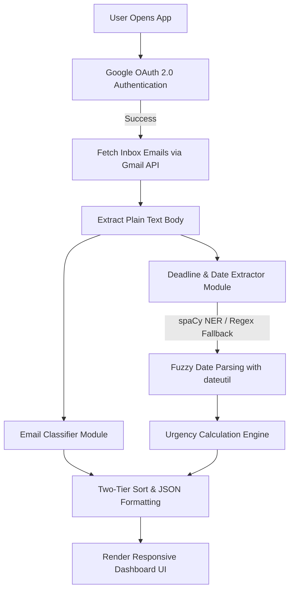

# MailWatch - AI-Powered Gmail Inbox Organizer

MailWatch is an intelligent, local web dashboard that connects directly to a user's Gmail inbox. It automatically categorizes emails and applies Natural Language Processing (NLP) to extract actionable deadlines, sorting your inbox by chronological urgency.

---

## 1. Project Title
**MailWatch: AI-Powered Gmail Inbox Organizer & Urgency Dashboard**

---

## 2. Problem Statement
Modern email communication suffers from severe information overload. Users are bombarded with promotions, notifications, and transactions, which obscure critical, time-sensitive emails. Traditional email clients do not possess native mechanisms to scan email bodies, identify response deadlines, and sort the inbox dynamically based on the urgency of these actions. As a result, users frequently miss deadlines for project submissions, meeting confirmations, RSVPs, or utility payments.

---

## 3. Introduction / Background
Email remains the primary channel for formal, academic, and business communication. However, checking each email manually to track dates is inefficient. MailWatch solves this by combining the **Google Gmail API** with local **Natural Language Processing (NLP)**. Using Named Entity Recognition (NER), the application scans message content to isolate dates linked to trigger phrases, dynamically calculating how many days remain before a response is required.

---

## 4. Objectives
* **OAuth 2.0 Integration:** Securely connect and authenticate users using official Google OAuth 2.0 endpoints.
* **Smart Category Classification:** Classify incoming emails into five distinct categories: `Work`, `Personal`, `Finance`, `Promotions`, and `Spam` based on custom domain, header, and keyword heuristic rules.
* **NLP-Driven Deadline Extraction:** Identify explicit deadlines within text bodies using the latest spaCy Named Entity Recognition model (`en_core_web_sm` v3.8.0 / pipeline architecture) coupled with robust regular expression fallbacks.
* **Urgency Prioritization:** Grade deadlines into `overdue`, `urgent`, `soon`, or `upcoming` classes and sort the dashboard to display critical items first.
* **Modern Web Interface:** Present a responsive, glassmorphism dark-themed dashboard to easily filter and read actionable messages.
* **Clues Sidebar & Evidence Docket:** Collapsible real-time docket drawer allowing instant full-text search, category filtering, jump-to-board focus, and dossier review across all retrieved emails.

---

## 5. Existing System
Traditional email clients (e.g., standard Gmail, Outlook, Yahoo) classify emails using simple category folders (Primary, Social, Updates, Forums) or rely on manual labeling by the user. 
### Drawbacks of Existing Systems:
* No automated extraction of deadlines hidden inside the body text.
* Inbox sorting is purely chronological based on the receipt date, rather than the deadline of the requested action.
* Missing integration between NLP context parsing and active inbox sorting.

---

## 6. Proposed System
The proposed system, **MailWatch**, introduces a context-aware approach to inbox sorting:
* **Retrieval:** Fetch the latest emails directly from the Gmail inbox.
* **Processing:** Decodes base64-encoded plain-text email bodies, passing them through NLP and regex parser modules.
* **Extraction:** Scans for temporal expressions located near response triggers (e.g. *"reply by"*, *"deadline is"*).
* **Display:** Sorts the processed emails using a custom two-tier logic: emails with active deadlines are prioritized chronologically ascending (nearest deadlines first), followed by non-deadline emails sorted descending by receipt date.
* **Clues Docket (Sidebar):** An interactive slide-out docket accessible via header button, floating side tab, or keyboard shortcut (`C` / `Ctrl+B`) that lists all clues in chronological sequence, offering live search, category pills, quick "Next Urgent" navigation, and immediate card centering with vibration feedback on the board.

---

## 7. Literature Survey / Related Work
* **Named Entity Recognition (NER) in Information Extraction:** Classic and contemporary NER systems extract locations, organizations, and temporal entities. Using spaCy's latest English pipeline (`en_core_web_sm` v3.8.0 with Tok2Vec embeddings) provides an optimal balance of sub-millisecond inference speed and high accuracy for parsing informal temporal tokens like "15 August" or "Dec 31" directly inside CPU-bound environments, with an upgrade path to transformer-based architectures (`en_core_web_trf` using RoBERTa).
* **Generative Foundation Models:** Integrating modern large language models (such as Google Gemini 1.5 Flash / Gemini 2.0) enables deep semantic disambiguation, complex multi-message intent extraction, and automated contextual reply composition.
* **Heuristic Classification Models:** Rule-based heuristics leveraging email headers (e.g. `List-Unsubscribe`), sender domains, and subject keywords provide rapid, lightweight classification without requiring heavy GPU-bound deep learning models.
* **OAuth 2.0 Authorization Code Flow with PKCE:** Implementing PKCE (Proof Key for Code Exchange) protects local web clients from authorization code injection attacks, ensuring secure access to Google's RESTful APIs.

---

## 8. Scope of the Project
### Current Scope:
* Integration with Gmail inbox (up to 30 latest messages dynamically retrieved).
* Local analysis of English-language emails for deadline patterns.
* Session and token caching to allow secure token refreshing.
* Desktop-based responsive browser dashboard.

### Future Scope:
* Support for IMAP/POP3 to integrate Outlook, Yahoo, and corporate mailboxes.
* Multi-language NLP support for recognizing non-English deadlines.
* Dynamic Google Calendar syncing to automatically add extracted deadlines.
* Automatic contextual draft generation of replies using latest generative AI models (Google Gemini 1.5 Flash / 2.0).
* Support for high-precision transformer NER pipelines (`en_core_web_trf`) for enterprise-grade parsing.

---

## 9. Methodology / Proposed Approach
The application operates in a pipeline of sequential phases:



### 1. Authentication
Uses Google’s Flow client to request offline access and prompts user consent to fetch credentials. Token details are stored in the signed Flask session cookie.

### 2. Processing and Classification
* **Text Extraction:** Decodes base64url payloads recursively to retrieve plain-text email bodies.
* **NLP Extraction:** Locates matches for defined trigger phrases (e.g. *"RSVP by"*). The 80-character snippet succeeding the trigger is analyzed by spaCy to detect `DATE` entities. If NER fails, a custom regex sequence parses date formats (e.g., `DD/MM/YYYY`, `Month DD, YYYY`, `DDth of Month`).
* **Fuzzy Parser:** Parses the date text with `dateutil.parser` using fuzzy matching.
* **Classifier:** Evaluates email sender domains, header metadata, and subject lines against a prioritized dictionary of spam, work, personal, and financial rules.

---

## 10. Technology Stack

### Programming Language
* **Python 3.8+** (Backend logic and data extraction)
* **JavaScript (ES6)** (Frontend dynamic rendering and filtering)

### Frameworks / Libraries
* **Flask:** Light-weight backend web server.
* **spaCy (`en_core_web_sm` v3.8.0):** Latest English NLP processing pipeline with Tok2Vec embeddings and transition-based NER (supports upgrade to `en_core_web_trf` / transformer models).
* **Generative AI Model Layer:** Support for latest Google Gemini models (Gemini 1.5 Flash / Gemini 2.0) for semantic intent understanding and smart reply drafting.
* **google-api-python-client & google-auth-oauthlib:** Secure communication with Gmail API.
* **python-dateutil:** For robust, fuzzy date parsing.

### Database
* **Stateless Architecture:** No external database is needed. Google Gmail serves as the remote source of truth, and Flask signed sessions cache tokens locally.

### Tools / Platforms
* **Google Cloud Console:** Manage OAuth 2.0 credentials and API scopes.
* **Git:** Version control.

---

## 11. System Architecture / Block Diagram

```
+-----------------------------------------------------------------------+
|                              Web Browser                              |
|          (Templates: login.html, index.html / CSS / Javascript)       |
+-------------------+-----------------------------------+---------------+
                    |                                   ^
       HTTP GET/POST|                                   | JSON Payload
                    v                                   |
+-----------------------------------------------------------------------+
|                            Flask Web Server                           |
|       (App Routing, Session Management, Configuration Verification)    |
+-------------------+-----------------------------------+---------------+
                    |                                   ^
      API Credentials|                                   | Message Data
                    v                                   |
+-------------------+---------+       +-----------------+---------------+
|        Google OAuth 2.0     |       |          Gmail API              |
|       (User Authentication) |       |     (List/Get Inbox Emails)     |
+-----------------------------+       +---------------------------------+
                                                        |
                                                        v
                                      +---------------------------------+
                                      |     NLP & Regular Expression    |
                                      |        Processing Engine        |
                                      |     - Classifier Heuristics     |
                                      |     - spaCy Date NER Parser     |
                                      |     - Urgency Sorting Engine    |
                                      +---------------------------------+
```

---

## 12. Modules of the Project
1. **OAuth Authentication Module:** Handles OAuth consent redirections, PKCE code challenges, and token refreshes.
2. **Gmail Connector Module:** Communicates with Google's Gmail API, pulls message headers, snippets, and decodes raw payloads.
3. **Classification Engine:** Computes categorization scores based on heuristics, tagging emails into priority buckets.
4. **NLP Extraction Engine:** Searches for key phrases, isolates local sub-strings, runs NER / Regex extractors, and parses calendar dates.
5. **Dashboard Rendering Module:** Asynchronous JS dashboard displaying stats, filters, deadline timelines, and unread metrics.
6. **Clues Sidebar & Docket Module:** Collapsible drawer interface providing indexable search, live category filtering, synchronization with board nodes, and one-click case dossier modal inspection.

---

## 13. Expected Outcome
* A fully interactive local web console that loads instantly.
* Real-time extraction showing the exact deadline date, urgency badge, and a contextual quote showing *why* that deadline was flagged.
* Quick-action tabs allowing the user to view only high-priority tasks (e.g. Work, Finance, Deadlines).
* Elimination of critical-deadline oversight by keeping actionable tasks pinned at the top of the interface.
* Collapsible Clues Sidebar to search, inspect, and jump directly to critical tasks on the board without losing investigative context.

---

## 14. Project Timeline / Work Plan

| Milestone | Task Description | Duration |
| :--- | :--- | :--- |
| **M1: Requirements & Setup** | Project scoping, Google Cloud credentials configuration, repository setup. | Week 1 |
| **M2: Core Authentication** | Setup Flask server, configure local session storage, build complete OAuth flow. | Week 2 |
| **M3: Data Retrieval** | Integrate Gmail API payload decoding and plain-text extraction. | Week 3 |
| **M4: NLP Date Extraction** | Integrate spaCy date NER, custom regex fallbacks, and dateutil fuzzy parsing. | Week 4 |
| **M5: Categorization & Sorting**| Implement score-based heuristics and chronological deadline prioritization. | Week 5 |
| **M6: UI/UX & Deployment** | Build responsive CSS dashboard UI, perform testing, finalize documentation. | Week 6 |

---

## 15. References
1. *Google OAuth 2.0 Web Client Documentation*: [https://developers.google.com/identity/protocols/oauth2](https://developers.google.com/identity/protocols/oauth2)
2. *spaCy Language Processing Pipeline & Models Guide (`en_core_web_sm` v3.8.0)*: [https://spacy.io/models/en#en_core_web_sm](https://spacy.io/models/en#en_core_web_sm)
3. *Google Gemini API & Models Documentation*: [https://ai.google.dev/gemini-api/docs/models/gemini](https://ai.google.dev/gemini-api/docs/models/gemini)
4. *Gmail API Reference Guide*: [https://developers.google.com/gmail/api/reference/rest](https://developers.google.com/gmail/api/reference/rest)
5. *Flask Session and Cookie Management Documentation*: [https://flask.palletsprojects.com/en/3.0.x/quickstart/#sessions](https://flask.palletsprojects.com/en/3.0.x/quickstart/#sessions)